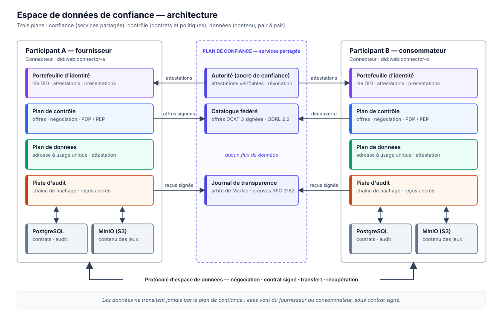
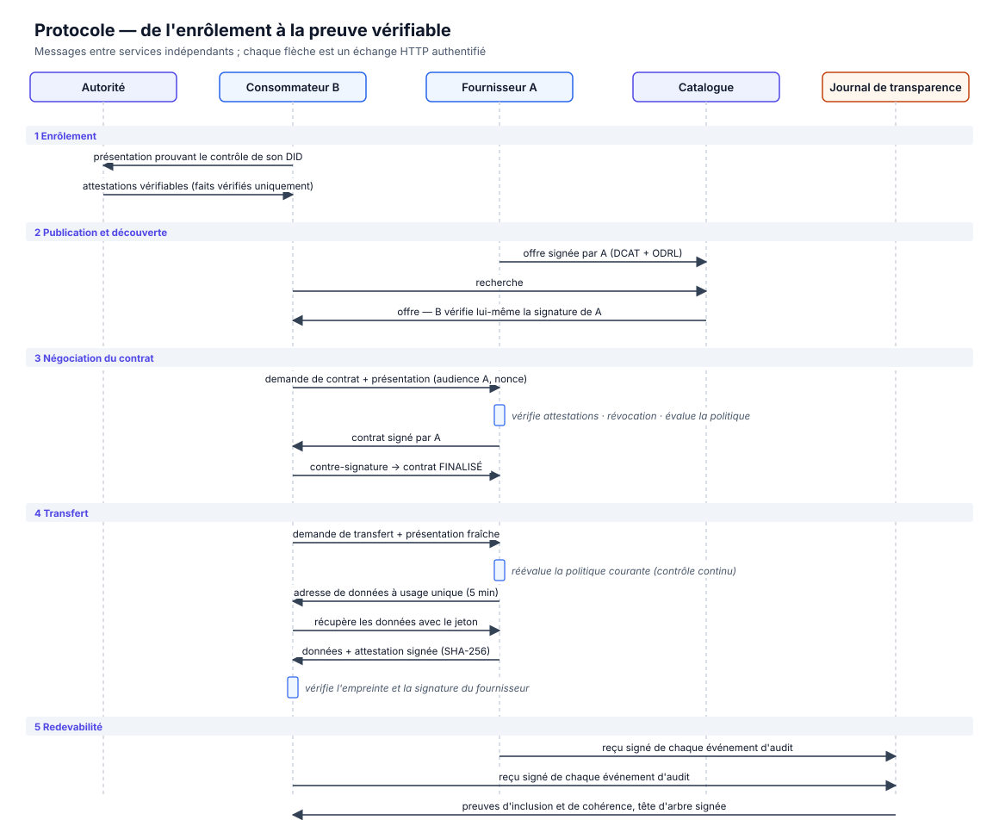

# Framework d'espace de données de confiance

[English](README.md) · **Français**

> **Résumé.** Les organisations détiennent des données dont la valeur se
> multiplie lorsqu'elles sont croisées avec celles des autres : hôpitaux et
> instituts de recherche, industriels et fournisseurs, villes et opérateurs de
> mobilité. Pourtant, elles les partagent rarement, car partager signifie
> aujourd'hui *perdre le contrôle* : une fois les données sorties de chez leur
> propriétaire, rien ne garantit qui les reçoit, à quelles fins elles sont
> utilisées, ni si les règles convenues sont respectées. Ce dépôt présente et
> implémente une architecture d'**espace de données de confiance**, dans
> lequel des organisations indépendantes échangent des données :
> (i) en les conservant à la source tant qu'aucun contrat n'existe ;
> (ii) en fondant la confiance sur des attributs *vérifiables* plutôt que
> *déclarés* ;
> (iii) en exprimant les conditions d'usage sous forme de politiques lisibles
> par machine, appliquées *en continu* ;
> (iv) en produisant, pour chaque échange, des preuves vérifiables par un
> tiers. Le prototype combine les identifiants décentralisés (DID) et les
> attestations vérifiables (Verifiable Credentials) du W3C, des politiques
> ODRL, une négociation de contrat bilatérale inspirée du Dataspace Protocol,
> et un journal de transparence de Merkle conforme à la RFC 9162.

---

## Sommaire

1. [Problématique](#1-problématique)
2. [Modèle de menace](#2-modèle-de-menace)
3. [Principes de conception](#3-principes-de-conception)
4. [Architecture](#4-architecture)
5. [Protocole](#5-protocole)
6. [Propriétés de sécurité](#6-propriétés-de-sécurité)
7. [Implémentation](#7-implémentation)
8. [Reproduire les résultats](#8-reproduire-les-résultats)
9. [Méthodologie d'évaluation](#9-méthodologie-dévaluation)
10. [Limites et travaux futurs](#10-limites-et-travaux-futurs)
11. [Références](#11-références)

---

## 1. Problématique

### 1.1 Contexte

La réglementation européenne vise explicitement un marché unique des
données :
- le Data Governance Act [R1] organise l'intermédiation de données ;
- le Data Act [R2] crée des droits d'accès aux données industrielles ;
- le RGPD [R3] encadre tout traitement de données personnelles.

Des initiatives comme IDSA [R4] et Gaia-X [R5] promeuvent les *espaces de
données* : des fédérations dans lesquelles les participants partagent des
données selon des règles communes, sans les confier à une plateforme
centrale.

### 1.2 Le déficit de confiance

Prenons un hôpital universitaire. Il pourrait faire progresser la recherche
en partageant des dossiers cliniques pseudonymisés avec un institut de
recherche d'un autre pays, mais il doit refuser ces mêmes données à une
entreprise d'analyse commerciale. Quatre obstacles empêchent aujourd'hui cet
échange :

| | Obstacle | Conséquence |
|---|---|---|
| **B1** | **Perte de contrôle.** Une fois copiées, les données échappent à leur propriétaire ; les clauses contractuelles ne sont pas liées techniquement aux données. | Les propriétaires refusent de partager leurs données sensibles. |
| **B2** | **Interlocuteurs invérifiables.** La juridiction, le secteur ou la certification d'un demandeur sont *auto-déclarés*. | Des politiques comme « UE uniquement » ou « certifié ISO 27001 uniquement » sont inapplicables. |
| **B3** | **Absence de preuve partagée.** Chaque partie tient ses propres journaux, qu'elle peut modifier. | Litiges et audits réglementaires ne peuvent être tranchés objectivement. |
| **B4** | **Centralisation.** Les intermédiaires de confiance voient toutes les données et deviennent des points uniques de défaillance et de confiance. | Les participants doivent faire davantage confiance à un opérateur qu'à leurs pairs. |

### 1.3 Question de recherche

> **QR.** *Comment des organisations indépendantes peuvent-elles partager des
> données de sorte que le propriétaire garde le contrôle de leur usage, que la
> confiance entre parties repose sur des faits vérifiables, et que chaque
> échange laisse une preuve vérifiable par un tiers, sans dépendre d'un
> intermédiaire central omniscient ?*

| | Sous-question | Traitée par |
|---|---|---|
| **QR1** | Comment fonder les décisions d'accès sur des attributs attestés plutôt que déclarés ? | Attestations vérifiables, émetteurs de confiance, révocation (§5.1) |
| **QR2** | Comment les conditions d'usage peuvent-elles rester applicables *après* la conclusion d'un contrat ? | Contrôle d'usage continu, à chaque utilisation (§5.4) |
| **QR3** | Comment lier les deux parties aux termes exacts qu'elles ont acceptés ? | Contrats signés par les deux parties (§5.3) |
| **QR4** | Comment garantir la redevabilité quand aucune partie, opérateur compris, n'est digne de confiance pour tenir les journaux ? | Pistes d'audit chaînées, ancrées dans un journal de transparence de Merkle (§5.5) |

---

## 2. Modèle de menace

Les **participants** sont des organisations indépendantes, chacune exploitant
son propre *connecteur*. Les **services partagés** (autorité, catalogue,
journal de transparence) sont exploités par l'instance de gouvernance de
l'espace de données.

| Adversaire | Capacités | Objectif |
|---|---|---|
| Consommateur malhonnête | Détient des clés valides ; forge, rejoue ou emprunte des attestations et des messages | Accéder à des données auxquelles il n'a pas droit, ou au-delà des termes convenus |
| Fournisseur malhonnête | Contrôle son stockage et ses journaux | Livrer des données altérées, nier un contrat, réécrire son historique |
| Opérateur curieux ou malhonnête | Exploite le catalogue et le journal | Substituer des offres, réécrire ou bifurquer le journal |
| Attaquant réseau | Observe et rejoue le trafic | Usurper un participant, rejouer une requête |

**Hypothèses :**
- Ed25519 et SHA-256 sont sûrs.
- Les clés privées restent chez leurs détenteurs.
- L'autorité vérifie correctement les faits *avant* de les attester (enrôlement hors ligne).
- En production, la résolution `did:web` est protégée par TLS.

**Hors périmètre :**
- l'application de l'usage *à l'intérieur* de l'infrastructure du consommateur après la livraison, qui exige des environnements d'exécution de confiance (voir §10) ;
- le déni de service ;
- les canaux auxiliaires.

---

## 3. Principes de conception

| | Principe | Réalisation |
|---|---|---|
| **P1** | *Souveraineté par conception* | Les données restent dans le connecteur du fournisseur ; le catalogue ne stocke que des offres ; les données circulent de pair à pair, uniquement sous contrat. |
| **P2** | *Confiance vérifiable* | Les politiques ne sont évaluées que sur des affirmations issues d'attestations valides d'émetteurs de confiance, présentées par leur titulaire. |
| **P3** | *Refus par défaut, moindre privilège* | Pas de règle, pas d'accès ; les interdictions l'emportent sur les permissions ; une affirmation non prouvée ne satisfait jamais une contrainte. |
| **P4** | *Contrôle d'usage continu* | Un contrat est nécessaire mais pas suffisant : chaque usage est réévalué selon la politique et les attestations courantes [R13]. |
| **P5** | *Non-répudiation* | Offres, contrats, livraisons de données et reçus d'audit sont signés par leur auteur. |
| **P6** | *Redevabilité vérifiable* | Chaque événement est inscrit dans un journal de Merkle en ajout seul (*append-only*), dont chacun peut vérifier les preuves [R10, R14]. |
| **P7** | *Alignement sur les standards* | DID [R6], VC 2.0 [R7], ODRL 2.2 [R8], DCAT 3 [R9], Dataspace Protocol [R11], RFC 9162 [R10]. |

---

## 4. Architecture

<p align="center"></p>

Le système sépare trois plans :

- Le **plan de confiance** (services partagés) établit *qui* sont les
  participants et rend leurs actions *publiquement vérifiables*. Il ne voit
  jamais les données.
- Le **plan de contrôle** (dans chaque connecteur) publie les offres, négocie
  les contrats, décide (point de décision, PDP) et applique (point
  d'application, PEP).
- Le **plan de données** (dans chaque connecteur) stocke le contenu et le
  livre de pair à pair, au moyen d'adresses de données à usage unique.

| Composant | Responsabilité | Confiance accordée |
|---|---|---|
| **Autorité** | Registre des faits vérifiés à l'enrôlement ; émet les attestations (adhésion, juridiction, secteur, certification) ; liste de révocation signée | Atteste correctement les faits. Ne peut ni accéder aux données, ni signer au nom des participants, ni altérer les journaux. |
| **Catalogue fédéré** | Index d'offres DCAT signées, portant des politiques ODRL | Aucune : les consommateurs revérifient la signature et le point d'accès de chaque offre. |
| **Journal de transparence** | Arbre de Merkle en ajout seul de reçus signés ; preuves d'inclusion et de cohérence ; têtes d'arbre signées | Aucune : les participants vérifient les preuves et détectent bifurcations et réécritures. |
| **Connecteur** | Portefeuille d'identité, plan de contrôle, plan de données, piste d'audit ; PostgreSQL pour l'état, stockage S3 (MinIO) pour le contenu | Exploité par son seul participant, et digne de sa seule confiance. |

Chaque service possède sa propre identité `did:web`, sa propre clé et sa
propre base de données. Dans le déploiement de référence, PostgreSQL contient
une base et un rôle par service, et MinIO un bucket par connecteur.

---

## 5. Protocole

<p align="center"></p>

### 5.1 Enrôlement : des attributs déclarés aux attributs attestés

Un connecteur prouve qu'il contrôle son DID en envoyant à l'autorité une
*présentation*, signée avec sa clé et liée à l'autorité (audience) ainsi qu'à
un nonce frais. L'autorité émet des attestations pour les faits inscrits dans
son registre pour ce DID, et **uniquement** pour ceux-là : un participant ne
peut ni obtenir ni forger une attestation de juridiction ou de certification
qu'il ne possède pas.

Un vérificateur n'accepte une présentation `vp` destinée à l'audience `v` que
si toutes les conditions suivantes sont réunies :
- la signature du titulaire est valide pour une clé de son document DID ;
- `domain(vp) = v` ;
- la preuve date de moins de 5 minutes ;
- le nonce n'a jamais été vu ;
- chaque attestation est signée par un émetteur de confiance, délivrée au
  titulaire, dans sa période de validité, et absente de la liste de
  révocation signée de l'émetteur.

Les affirmations vérifiées forment le **sujet** `s` utilisé par les
politiques.

### 5.2 Publication et découverte

Un fournisseur publie une **offre**. Celle-ci contient :
- une description DCAT 3 ;
- l'empreinte SHA-256 du contenu ;
- son point d'accès protocolaire ;
- sa politique, sous forme d'`Offer` ODRL 2.2.

L'ensemble est signé avec sa clé DID. Le catalogue n'accepte une offre que si
la signature est valide et si le point d'accès correspond au document DID du
fournisseur, ce qui empêche le détournement de point d'accès. Les
consommateurs revérifient eux-mêmes les offres.

### 5.3 Négociation du contrat

```
REQUESTED ──(fournisseur : attestations valides ∧ politique favorable)──► AGREED ──(contre-signature du consommateur)──► FINALIZED
    └──────────────────────(sinon, avec la raison)──────────────────────► TERMINATED
```

**Sémantique des politiques.** On note :
- `π` une politique ;
- `a` une action ;
- `s` le sujet vérifié ;
- `p` la finalité déclarée ;
- `n` le nombre d'usages passés.

Une règle `r` *s'applique* si `a ∈ actions(r)` et si `s` figure parmi ses
bénéficiaires, lorsqu'il y en a. Une contrainte n'est satisfaite que si son
opérande gauche est *connu* : une affirmation non prouvée ne satisfait
jamais une contrainte, même négative. La décision est :

```
D(π, a, s, p, n) = refus                   s'il existe une interdiction r applicable dont toutes les contraintes sont satisfaites
                 = permis(r, devoirs(r))   sinon, s'il existe une permission r applicable dont toutes les contraintes sont satisfaites
                 = refus                   dans tous les autres cas
```

Les opérateurs sont ceux d'ODRL : `eq`, `neq`, `lt`, `lteq`, `gt`, `gteq`,
`isAnyOf`, `isNoneOf`, `hasPart`. Chaque décision porte son explication, par
exemple `constraints not satisfied: participant.region eq 'EU'`.

Si l'accès est permis, le fournisseur émet un **contrat** et le signe. Ce
contrat lie l'empreinte du jeu de données, l'action, la finalité, la version
de la politique, les devoirs et la durée de validité. Le consommateur
vérifie que le contrat correspond à sa demande, puis le contre-signe. Les
deux parties détiennent le même document doublement signé : aucune ne peut
ensuite en nier les termes.

### 5.4 Transfert et contrôle d'usage continu

Chaque demande de transfert porte une *nouvelle* présentation. Le
fournisseur la rejette si le contrat est révoqué ou expiré, ou si le jeu de
données a été retiré. Sinon, il **réévalue la politique courante au regard
des attestations courantes**. Un durcissement de la politique, une
attestation révoquée ou un quota d'usage épuisé prennent donc effet
immédiatement, y compris sur les contrats déjà conclus.

Si l'accès est toujours permis, le fournisseur renvoie une adresse de
données à usage unique, valable 5 minutes. Le consommateur récupère le
contenu et reçoit une attestation signée de son empreinte. Il n'accepte les
données que si l'attestation est valide et si l'empreinte correspond au
contrat.

### 5.5 Redevabilité

Chaque connecteur tient une piste d'audit locale chaînée par hachage : chaque
événement s'engage sur le hachage de son prédécesseur [R14]. Une chaîne de
hachage seule n'empêche pas son *propriétaire* de réécrire l'historique en
recalculant tous les hachages. Le connecteur envoie donc au journal de
transparence un **reçu signé** du hachage de chaque événement. Le journal
l'ajoute à un arbre de Merkle (RFC 9162) et renvoie une tête d'arbre signée.

Un auditeur, ou le participant lui-même, peut alors vérifier :
- **l'inclusion** : un événement figure dans le journal, avec une preuve de
  taille `O(log n)` ;
- **la cohérence** : un arbre ultérieur prolonge un arbre antérieur. Le
  journal n'a donc fait que croître, et ni un participant ni l'opérateur du
  journal n'a réécrit le passé.

Fournisseur et consommateur journalisent l'empreinte du même contrat : chaque
contrat est ainsi attesté par deux enregistrements indépendants, ancrés
publiquement.

---

## 6. Propriétés de sécurité

| Menace | Mécanisme | Vérifié par |
|---|---|---|
| Attributs auto-déclarés | Seules comptent les attestations d'émetteurs de confiance | `tests/integration/test_identity.py::test_self_issued_credential_is_rejected` |
| Usurpation d'un DID | Signature vérifiée contre le document DID | `test_identity.py::test_unregistered_entity_gets_no_credentials` |
| Rejeu ou détournement d'une présentation | Liaison à l'audience, fraîcheur, cache des nonces | `test_identity.py::test_presentation_bound_to_audience_and_not_replayable` |
| Usage d'attestations révoquées | Liste de révocation signée, vérifiée à chaque usage | `test_identity.py::test_revoked_credentials_block_access` |
| Détournement du point d'accès d'une offre | Le point d'accès doit correspondre au document DID | `test_identity.py::test_offer_endpoint_must_match_provider_did_document` |
| Demande non éligible | PDP en refus par défaut, décisions expliquées | `test_contracts.py::test_ineligible_requests_are_terminated_with_reason` |
| Contrat altéré par le fournisseur | Le consommateur vérifie signature et termes avant de contre-signer | `test_contracts.py::test_consumer_rejects_agreement_that_differs_from_request` |
| Usage après changement de politique | Réévaluation à chaque transfert | `test_transfers.py::test_policy_change_applies_to_existing_agreements` |
| Dépassement du quota d'usage | Contrainte `usage_count` évaluée à chaque usage | `test_transfers.py::test_usage_limit_is_enforced_across_transfers` |
| Contrat volé | Contrat lié au DID du consommateur | `test_transfers.py::test_agreement_cannot_be_used_by_another_participant` |
| Données altérées | Empreinte dans le contrat + attestation signée | `test_transfers.py::test_tampered_provider_data_is_detected` |
| Réutilisation d'une adresse de données | Jeton à usage unique et de courte durée | `test_transfers.py::test_data_address_is_single_use` |
| Falsification du journal local | Chaîne de hachage | `test_accountability.py::test_local_rewrite_is_detected` |
| Opérateur recalculant sa chaîne | Ancrages dans le journal de transparence | `test_accountability.py::test_operator_recomputing_the_chain_is_caught_by_the_log` |
| Réécriture ou bifurcation du journal | Preuves de cohérence RFC 9162 | `test_accountability.py::test_log_history_rewrite_is_detected` |

Les preuves de Merkle sont en outre confrontées aux algorithmes de la
RFC 9162 sur des arbres de 1 à 33 feuilles, historique réécrit compris
(`tests/unit/test_merkle.py`).

---

## 7. Implémentation

| Aspect | Choix |
|---|---|
| Langage et services | Python 3.11+, FastAPI ; chaque service est une application ASGI indépendante |
| Identité | `did:web`, clés Ed25519 (JWK), modèle de données VC 2.0 du W3C, preuves Data Integrity sur le modèle d'`eddsa-jcs-2022` |
| Politiques | Modèle d'information ODRL 2.2 et sérialisation JSON-LD |
| Catalogue | Descriptions de jeux de données DCAT 3 (vue JSON-LD disponible) |
| Redevabilité | Arbre de Merkle RFC 9162, avec preuves d'inclusion et de cohérence |
| Persistance | SQLAlchemy (PostgreSQL en déploiement, SQLite en test) ; stockage objet S3 (MinIO) |
| Erreurs | Documents de problème RFC 9457, relevés comme exceptions typées d'un service à l'autre |

```
src/dataspace/
  common/        cryptographie (Ed25519, JCS), stockage de documents et d'objets, erreurs HTTP
  identity/      DID (did:web), preuves, attestations et présentations vérifiables, portefeuille
  policy/        modèle ODRL, point de décision, import/export ODRL JSON-LD
  protocol/      messages : offres, négociation, contrats, transferts
  audit/         piste d'audit chaînée, preuves de Merkle RFC 9162, reçus
  services/
    authority/     ancre de confiance : émission et révocation des attestations
    catalog/       catalogue fédéré d'offres signées
    transparency/  journal de transparence de Merkle
    connector/     plan de contrôle, plan de données, API protocole et API de gestion
  client.py      client de l'API de gestion
  sim.py         déploiement en mémoire de l'espace de données complet
participants/    profils et données d'exemple de A (hôpital, FR), B (institut, DE), C (entreprise, US)
infrastructure/  registre de l'autorité, initialisation PostgreSQL, notes MinIO
docs/figures/    figures et leur générateur (docs/figures/build.py)
scripts/         demo.py (scénario commenté), smoke_test.py (vérifie un déploiement)
tests/           tests unitaires et d'intégration
```

---

## 8. Reproduire les résultats

**Prérequis :** Python ≥ 3.11, et Docker pour le déploiement complet.

```bash
python -m venv .venv && source .venv/bin/activate
pip install -r requirements.txt

pytest                       # 79 tests : unitaires, protocole et scénarios d'attaque
python scripts/demo.py       # scénario commenté : identité, contrats, contrôle, attaques, preuves
```

Les tests et la démo exécutent l'espace de données complet dans un seul
processus (`dataspace.sim.LocalDataSpace`). Les services communiquent en HTTP
exactement comme en déploiement ; seules les requêtes sont acheminées en
mémoire.

**Déploiement complet** (8 conteneurs : 3 services partagés, 3 connecteurs,
PostgreSQL et MinIO) :

```bash
docker compose up --build -d
python scripts/smoke_test.py     # négociation, transfert et vérification d'audit entre conteneurs
```

| Service | URL | API interactive |
|---|---|---|
| Connecteurs A, B, C | `http://localhost:8001`, `:8002`, `:8003` | `/docs` (clé de gestion `participant_a-key`, …) |
| Autorité | `http://localhost:8100` | `/docs` |
| Catalogue | `http://localhost:8101` | `/docs` |
| Journal de transparence | `http://localhost:8102` | `/docs` |
| Console MinIO | `http://localhost:9001` | — |

L'image officielle `minio/minio` n'est plus publiée. Le déploiement utilise
la dernière version Bitnami du serveur MinIO ; tout stockage compatible S3
peut la remplacer.

---

## 9. Méthodologie d'évaluation

L'évaluation est en cours. Elle mesurera le coût de chaque mécanisme de
confiance par rapport à une référence qui en est dépourvue :

| | Expérience | Mesure |
|---|---|---|
| **E1** | Coût de la décision selon le nombre de règles et de contraintes | Latence du PDP (médiane, p95) |
| **E2** | Coût de bout en bout de la négociation et du transfert, avec et sans vérification des attestations et ancrage | Latence, nombre de messages, octets |
| **E3** | Passage à l'échelle du journal de transparence | Débit d'ajout ; taille et temps de vérification des preuves en fonction de `log n` |
| **E4** | Efficacité face au modèle de menace | Taux de détection sur les scénarios d'attaque du §6 |

---

## 10. Limites et travaux futurs

- **Application après la livraison.** Une fois les données livrées, des
  devoirs comme « supprimer après 30 jours » sont *acceptés et journalisés*,
  mais pas appliqués techniquement. Le calcul au plus près des données
  (*compute-to-data*) ou les environnements d'exécution de confiance
  combleraient cette lacune.
- **Autorité et opérateur de journal uniques.** Plusieurs émetteurs
  pourraient attester des faits différents. Des témoins indépendants
  pourraient recouper les têtes d'arbre (*gossip*), pour détecter un journal
  qui montrerait des vues différentes à différents participants.
- **Confidentialité des affirmations.** Les présentations divulguent toutes
  les affirmations. La divulgation sélective (SD-JWT, signatures BBS) ne
  révélerait que ce dont la politique a besoin.
- **Fidélité au protocole.** La négociation et le transfert suivent les
  machines à états du Dataspace Protocol, mais pas encore son format
  d'échange. Le format de preuve est une simplification d'`eddsa-jcs-2022`.
  L'interopérabilité avec Eclipse EDC est un objectif.
- **Sécurité du transport.** Le déploiement de développement utilise HTTP
  entre conteneurs ; `did:web` exige HTTPS en production.

---

## 11. Références

- **[R1]** Règlement (UE) 2022/868 — *Règlement sur la gouvernance des données (Data Governance Act)*.
- **[R2]** Règlement (UE) 2023/2854 — *Règlement sur les données (Data Act)*.
- **[R3]** Règlement (UE) 2016/679 — *Règlement général sur la protection des données*.
- **[R4]** International Data Spaces Association. *IDS Reference Architecture Model*, version 4.
- **[R5]** Gaia-X European Association for Data and Cloud. *Gaia-X Architecture Document*.
- **[R6]** W3C. *Decentralized Identifiers (DIDs) v1.0*. Recommandation, 2022.
- **[R7]** W3C. *Verifiable Credentials Data Model v2.0*. Recommandation, 2025.
- **[R8]** W3C. *ODRL Information Model 2.2*. Recommandation, 2018.
- **[R9]** W3C. *Data Catalog Vocabulary (DCAT) — Version 3*. Recommandation, 2024.
- **[R10]** B. Laurie, E. Messeri, R. Stradling. *Certificate Transparency Version 2.0*. RFC 9162, 2021.
- **[R11]** Eclipse Dataspace Working Group (anciennement IDSA). *Dataspace Protocol*.
- **[R12]** A. Rundgren, B. Jordan, S. Erdtman. *JSON Canonicalization Scheme (JCS)*. RFC 8785, 2020.
- **[R13]** J. Park, R. Sandhu. *The UCON_ABC Usage Control Model*. ACM Transactions on Information and System Security 7(1), 2004.
- **[R14]** S. A. Crosby, D. S. Wallach. *Efficient Data Structures for Tamper-Evident Logging*. USENIX Security Symposium, 2009.
- **[R15]** B. Schneier, J. Kelsey. *Secure Audit Logs to Support Computer Forensics*. ACM Transactions on Information and System Security 2(2), 1999.
- **[R16]** B. Otto, M. ten Hompel, S. Wrobel (dir.). *Designing Data Spaces: The Ecosystem Approach to Competitive Advantage*. Springer, 2022.

---

*Auteur : Soumaila Niampa — projet de recherche doctorale.*
