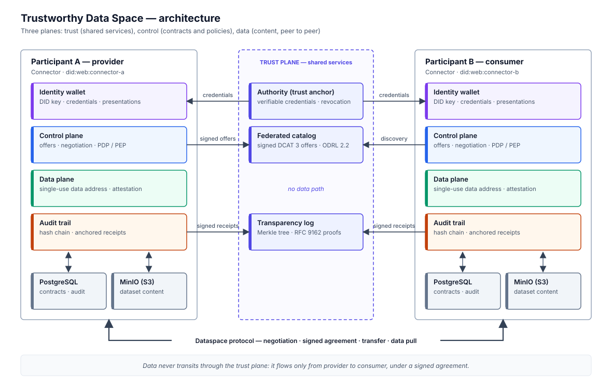
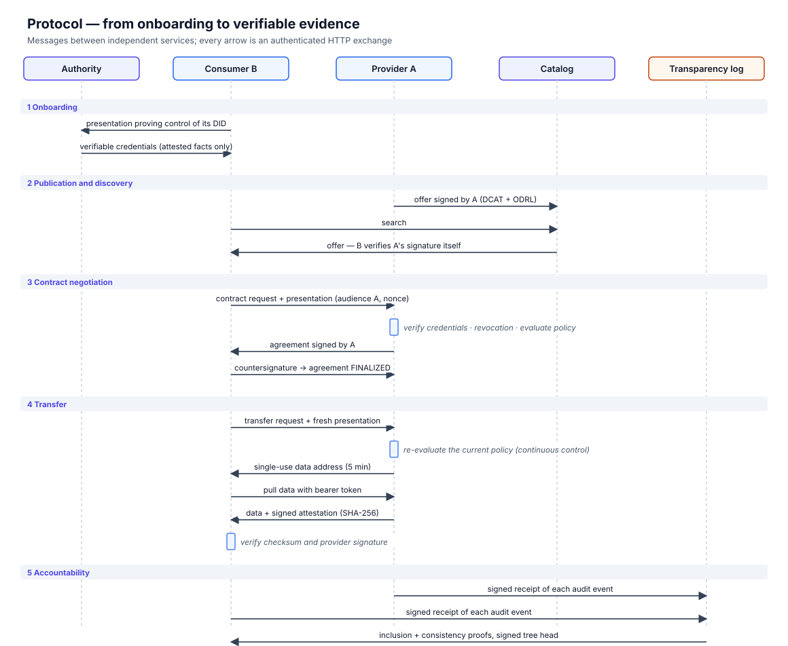

# Trustworthy Data Space Framework

**English** · [Français](README.fr.md)

> **Abstract.** Organisations hold data whose value multiplies when combined
> with that of others: hospitals and research institutes, manufacturers and
> their suppliers, cities and mobility operators. Yet they rarely share it,
> because sharing today means *losing control*: once data leaves its owner,
> nothing guarantees who receives it, what it is used for, or whether the
> agreed rules are respected. This repository presents and implements an
> architecture for a **trustworthy data space**, in which independent
> organisations exchange data while (i) keeping it at the source until a
> contract exists, (ii) establishing trust from *verifiable* rather than
> *declared* attributes, (iii) expressing usage conditions as machine-readable
> policies that are enforced *continuously*, and (iv) producing evidence of
> every exchange that third parties can verify. The prototype combines W3C
> Decentralized Identifiers and Verifiable Credentials, ODRL policies, a
> bilateral contract negotiation inspired by the Dataspace Protocol, and an
> RFC 9162 Merkle transparency log.

---

## Contents

1. [Problem statement](#1-problem-statement)
2. [Threat model](#2-threat-model)
3. [Design principles](#3-design-principles)
4. [Architecture](#4-architecture)
5. [Protocol](#5-protocol)
6. [Security properties](#6-security-properties)
7. [Implementation](#7-implementation)
8. [Reproducing the results](#8-reproducing-the-results)
9. [Evaluation methodology](#9-evaluation-methodology)
10. [Limitations and future work](#10-limitations-and-future-work)
11. [References](#11-references)

---

## 1. Problem statement

### 1.1 Context

European regulation explicitly aims at a single market for data: the Data
Governance Act [R1] organises data intermediation, the Data Act [R2] creates
rights of access to industrial data, and the GDPR [R3] constrains any
processing of personal data. Initiatives such as IDSA [R4] and Gaia-X [R5]
promote *data spaces*: federations in which participants share data under
common rules without surrendering it to a central platform.

### 1.2 The trust gap

Consider a university hospital that could advance research by sharing
pseudonymised clinical records with a research institute in another country,
but must refuse the same data to a commercial analytics company. Four
barriers prevent this exchange today:

| | Barrier | Consequence |
|---|---|---|
| **B1** | **Loss of control.** Once copied, data escapes its owner; contractual clauses are not technically bound to the data. | Owners refuse to share sensitive data. |
| **B2** | **Unverifiable counterparts.** A requester's jurisdiction, sector or certification are *self-declared*. | Policies such as "EU only" or "ISO 27001 certified only" are unenforceable. |
| **B3** | **No shared evidence.** Each party keeps its own logs, which it can alter. | Disputes and regulatory audits cannot be settled objectively. |
| **B4** | **Centralisation.** Trusted intermediaries see all data and become single points of failure and of trust. | Participants must trust an operator more than each other. |

### 1.3 Research question

> **RQ.** *How can independent organisations share data so that the owner
> keeps control over its use, trust between parties rests on verifiable
> facts, and every exchange leaves evidence that a third party can verify,
> without relying on an all-seeing central intermediary?*

| | Sub-question | Addressed by |
|---|---|---|
| **RQ1** | How can access decisions rely on attested rather than declared attributes? | Verifiable credentials, trusted issuers, revocation (§5.1) |
| **RQ2** | How can usage conditions remain enforceable *after* an agreement is concluded? | Continuous usage control at every use (§5.4) |
| **RQ3** | How can both parties be bound to the exact terms they agreed upon? | Bilaterally signed agreements (§5.3) |
| **RQ4** | How can accountability be achieved when no party, including the operator, is trusted with the logs? | Hash-chained trails anchored in a Merkle transparency log (§5.5) |

---

## 2. Threat model

**Participants** are independent organisations, each operating its own
*connector*. **Shared services** (authority, catalog, transparency log) are
operated by the data space governance body.

| Adversary | Capability | Goal |
|---|---|---|
| Dishonest consumer | Holds valid keys; forges, replays or borrows claims and messages | Access data it is not entitled to, or beyond the agreed terms |
| Dishonest provider | Controls its storage and logs | Serve altered data, deny an agreement, rewrite its history |
| Curious or dishonest operator | Runs catalog and log | Substitute offers, rewrite or fork the log |
| Network attacker | Observes and replays traffic | Impersonate a participant, replay a request |

**Assumptions.** Ed25519 and SHA-256 are secure; private keys stay with their
holders; the authority verifies facts correctly *before* attesting them
(out-of-band onboarding); `did:web` resolution is protected by TLS in
production.

**Out of scope.** Enforcement of usage *inside* the consumer's infrastructure
after delivery (it requires trusted execution environments, see §10), denial
of service, and side channels.

---

## 3. Design principles

| | Principle | Realisation |
|---|---|---|
| **P1** | *Sovereignty by design* | Data stays in the provider's connector; the catalog stores offers only; data moves peer to peer, only under a contract. |
| **P2** | *Verifiable trust* | Policies are evaluated only on claims from valid credentials of trusted issuers, presented by their subject. |
| **P3** | *Deny by default, least privilege* | No rule, no access; prohibitions override permissions; unproven claims never satisfy a constraint. |
| **P4** | *Continuous usage control* | An agreement is necessary but not sufficient: every use is re-evaluated against the current policy and credentials [R13]. |
| **P5** | *Non-repudiation* | Offers, agreements, data deliveries and audit receipts are signed by their author. |
| **P6** | *Verifiable accountability* | Every event is committed to an append-only Merkle log whose proofs anyone can check [R10, R14]. |
| **P7** | *Standards alignment* | DID [R6], VC 2.0 [R7], ODRL 2.2 [R8], DCAT 3 [R9], Dataspace Protocol [R11], RFC 9162 [R10]. |

---

## 4. Architecture

<p align="center"></p>

The system separates three planes:

- **Trust plane** (shared services) establishes *who* participants are and
  makes their actions *publicly verifiable*. It never sees data.
- **Control plane** (in each connector) publishes offers, negotiates
  contracts, decides (policy decision point, PDP) and enforces (policy
  enforcement point, PEP).
- **Data plane** (in each connector) stores content and delivers it, peer to
  peer, through single-use data addresses.

| Component | Responsibility | Trust placed in it |
|---|---|---|
| **Authority** | Registry of facts verified at onboarding; issues credentials (membership, jurisdiction, sector, certification); signed revocation list | Attests facts correctly. Cannot access data, sign on behalf of participants, or alter logs. |
| **Federated catalog** | Index of signed DCAT offers carrying ODRL policies | None: consumers re-verify every offer's signature and endpoint. |
| **Transparency log** | Append-only Merkle tree of signed receipts; inclusion and consistency proofs; signed tree heads | None: participants verify proofs and detect forks or rewrites. |
| **Connector** | Identity wallet, control plane, data plane, audit trail; PostgreSQL for state, S3 storage (MinIO) for content | Operated by, and trusted by, its own participant only. |

Each service has its own `did:web` identity, its own key, and its own
database. In the reference deployment, PostgreSQL holds one database and
role per service, and MinIO holds one bucket per connector.

---

## 5. Protocol

<p align="center"></p>

### 5.1 Onboarding: from declared to attested attributes

A connector proves control of its DID by sending the authority a
*presentation* signed with its key and bound to the authority (audience) and
to a fresh nonce. The authority issues credentials for the facts recorded in
its registry for that DID, and **only** those: a participant cannot obtain
or forge a credential for a jurisdiction or certification it does not have.

A verifier accepts a presentation `vp` for audience `v` only if all hold:
the holder's signature is valid for a key listed in its DID document;
`domain(vp) = v`; the proof is at most 5 minutes old; the nonce has not been
seen before; and every credential is signed by a trusted issuer, issued to
the holder, within its validity period and absent from the issuer's signed
revocation list. The verified claims form the **subject** `s` used by
policies.

### 5.2 Publication and discovery

A provider publishes an **offer**: a DCAT 3 description, the SHA-256 checksum
of the content, its protocol endpoint, and its policy as an ODRL 2.2 `Offer`,
all signed with its DID key. The catalog accepts an offer only if the
signature is valid and the endpoint matches the provider's DID document,
which prevents endpoint hijacking. Consumers verify offers again
themselves.

### 5.3 Contract negotiation

```
REQUESTED ──(provider: credentials valid ∧ policy permits)──► AGREED ──(consumer countersigns)──► FINALIZED
    └──────────────(otherwise, with the reason)──────────────► TERMINATED
```

**Policy semantics.** Let `π` be a policy, `a` an action, `s` the verified
subject, `p` the declared purpose and `n` the past usage count. A rule `r`
*applies* if `a ∈ actions(r)` and `s` is among its assignees, if any. A
constraint is satisfied only if its left operand is *known*: an unproven
claim never satisfies a constraint, even a negative one. The decision is:

```
D(π, a, s, p, n) = deny                    if ∃ prohibition r applicable with all constraints satisfied
                 = permit(r, duties(r))    else if ∃ permission r applicable with all constraints satisfied
                 = deny                    otherwise
```

Operators follow ODRL (`eq`, `neq`, `lt`, `lteq`, `gt`, `gteq`, `isAnyOf`,
`isNoneOf`, `hasPart`). Every decision carries its explanation, for example
`constraints not satisfied: participant.region eq 'EU'`.

When access is permitted, the provider issues an **agreement** binding the
dataset checksum, action, purpose, policy version, duties and validity, and
signs it. The consumer checks that the agreement matches its request, then
countersigns. Both parties hold the same doubly-signed document: neither can
later deny its terms.

### 5.4 Transfer and continuous usage control

Each transfer request carries a *new* presentation. The provider rejects it
if the agreement is revoked or expired, or the dataset was withdrawn, and
otherwise **re-evaluates the current policy against the current
credentials**. A tightened policy, a revoked credential or an exhausted usage
budget therefore takes effect immediately, including on agreements already
concluded.

If access is still permitted, the provider returns a single-use data address
valid for 5 minutes. The consumer pulls the content and receives a signed
attestation of its checksum. It accepts the data only if the attestation is
valid and the checksum matches the agreement.

### 5.5 Accountability

Each connector keeps a local, hash-chained audit trail, where each event
commits to the hash of its predecessor [R14]. A hash chain alone does not
stop its *owner* from rewriting history and recomputing every hash. The
connector therefore sends a **signed receipt** of every event hash to the
transparency log, which appends it to a Merkle tree (RFC 9162) and returns a
signed tree head. An auditor, or the participant itself, can then verify:

- **inclusion**: an event is in the log, with a proof of size `O(log n)`;
- **consistency**: a later tree extends an earlier one, so the log only
  grew, and neither a participant nor the log operator rewrote the past.

Provider and consumer log the digest of the same agreement, which gives two
independent, publicly anchored records of every contract.

---

## 6. Security properties

| Threat | Mechanism | Verified by |
|---|---|---|
| Self-declared attributes | Credentials from trusted issuers only | `tests/integration/test_identity.py::test_self_issued_credential_is_rejected` |
| Impersonation of a DID | Signature checked against the DID document | `test_identity.py::test_unregistered_entity_gets_no_credentials` |
| Replay or redirection of a presentation | Audience binding, freshness, nonce cache | `test_identity.py::test_presentation_bound_to_audience_and_not_replayable` |
| Use of revoked credentials | Signed revocation list checked at every use | `test_identity.py::test_revoked_credentials_block_access` |
| Offer endpoint hijacking | Endpoint must match the DID document | `test_identity.py::test_offer_endpoint_must_match_provider_did_document` |
| Ineligible request | Deny-by-default PDP with explained decisions | `test_contracts.py::test_ineligible_requests_are_terminated_with_reason` |
| Agreement altered by the provider | Consumer verifies signature and terms before countersigning | `test_contracts.py::test_consumer_rejects_agreement_that_differs_from_request` |
| Use after a policy change | Re-evaluation at every transfer | `test_transfers.py::test_policy_change_applies_to_existing_agreements` |
| Exceeding the usage budget | `usage_count` constraint evaluated at every use | `test_transfers.py::test_usage_limit_is_enforced_across_transfers` |
| Stolen agreement | Agreement bound to the consumer's DID | `test_transfers.py::test_agreement_cannot_be_used_by_another_participant` |
| Altered data | Checksum in the agreement + signed attestation | `test_transfers.py::test_tampered_provider_data_is_detected` |
| Reused data address | Single-use, short-lived token | `test_transfers.py::test_data_address_is_single_use` |
| Local log tampering | Hash chain | `test_accountability.py::test_local_rewrite_is_detected` |
| Operator recomputing its chain | Anchors in the transparency log | `test_accountability.py::test_operator_recomputing_the_chain_is_caught_by_the_log` |
| Log history rewrite or fork | RFC 9162 consistency proofs | `test_accountability.py::test_log_history_rewrite_is_detected` |

The Merkle proofs are also checked against the RFC 9162 algorithms on tree
sizes from 1 to 33, including a rewritten history
(`tests/unit/test_merkle.py`).

---

## 7. Implementation

| Concern | Choice |
|---|---|
| Language and services | Python 3.11+, FastAPI; each service is an independent ASGI application |
| Identity | `did:web`, Ed25519 keys (JWK), W3C VC 2.0 data model, Data Integrity proofs modelled on `eddsa-jcs-2022` |
| Policies | ODRL 2.2 information model and JSON-LD serialisation |
| Catalog | DCAT 3 dataset descriptions (JSON-LD view available) |
| Accountability | RFC 9162 Merkle tree with inclusion and consistency proofs |
| Persistence | SQLAlchemy (PostgreSQL in deployment, SQLite in tests); S3 object storage (MinIO) |
| Errors | RFC 9457 problem documents, re-raised as typed exceptions across services |

```
src/dataspace/
  common/        crypto (Ed25519, JCS), document store, object storage, HTTP errors
  identity/      DIDs (did:web), proofs, verifiable credentials and presentations, wallet
  policy/        ODRL model, policy decision point, ODRL JSON-LD import/export
  protocol/      messages: catalog offers, negotiation, agreements, transfers
  audit/         hash-chained audit trail, RFC 9162 Merkle proofs, receipts
  services/
    authority/     trust anchor: credential issuance and revocation
    catalog/       federated catalog of signed offers
    transparency/  Merkle transparency log
    connector/     control plane, data plane, protocol and management APIs
  client.py      client of the management API
  sim.py         in-process deployment of the whole data space
participants/    profiles and sample data of A (hospital, FR), B (institute, DE), C (company, US)
infrastructure/  authority registry, PostgreSQL initialisation, MinIO notes
docs/figures/    figures and their generator (docs/figures/build.py)
scripts/         demo.py (narrated scenario), smoke_test.py (checks a deployment)
tests/           unit and integration tests
```

---

## 8. Reproducing the results

**Requirements:** Python ≥ 3.11; Docker for the full deployment.

```bash
python -m venv .venv && source .venv/bin/activate
pip install -r requirements.txt

pytest                       # 79 tests: unit, protocol and attack scenarios
python scripts/demo.py       # narrated scenario: identity, contracts, control, attacks, evidence
```

The tests and the demo run the complete data space in a single process
(`dataspace.sim.LocalDataSpace`): services communicate over HTTP exactly as
deployed, with requests routed in memory.

**Full deployment** (8 containers: 3 shared services, 3 connectors,
PostgreSQL, MinIO):

```bash
docker compose up --build -d
python scripts/smoke_test.py     # negotiation, transfer and audit verification across containers
```

| Service | URL | Interactive API |
|---|---|---|
| Connector A, B, C | `http://localhost:8001`, `:8002`, `:8003` | `/docs` (management key `participant_a-key`, …) |
| Authority | `http://localhost:8100` | `/docs` |
| Catalog | `http://localhost:8101` | `/docs` |
| Transparency log | `http://localhost:8102` | `/docs` |
| MinIO console | `http://localhost:9001` | — |

The official `minio/minio` image is no longer published. The deployment uses
the last Bitnami build of the MinIO server; any S3-compatible store can
replace it.

---

## 9. Evaluation methodology

The evaluation, in progress, will measure the cost of each trust mechanism
against a baseline without it:

| | Experiment | Metric |
|---|---|---|
| **E1** | Policy decision cost as a function of rules and constraints | PDP latency (median, p95) |
| **E2** | End-to-end cost of negotiation and transfer, with and without credential verification and anchoring | latency, messages, bytes |
| **E3** | Scalability of the transparency log | append throughput; proof size and verification time against `log n` |
| **E4** | Effectiveness against the threat model | detection rate over the attack scenarios of §6 |

---

## 10. Limitations and future work

- **Enforcement after delivery.** Once data is delivered, duties such as
  "delete after 30 days" are *agreed and recorded* but not technically
  enforced. Compute-to-data or trusted execution environments would close
  this gap.
- **Single authority and log operator.** Several issuers could attest
  different facts, and independent witnesses could cross-check tree heads
  (gossip) to detect a log showing different views to different
  participants.
- **Privacy of claims.** Presentations disclose every claim. Selective
  disclosure (SD-JWT, BBS signatures) would reveal only what a policy needs.
- **Protocol fidelity.** The negotiation and transfer follow the state
  machines of the Dataspace Protocol, but not yet its wire format; the proof
  format is a simplification of `eddsa-jcs-2022`. Interoperability with
  Eclipse EDC is an objective.
- **Transport security.** The development deployment uses HTTP between
  containers. `did:web` requires HTTPS in production.

---

## 11. References

- **[R1]** Regulation (EU) 2022/868 — *Data Governance Act*.
- **[R2]** Regulation (EU) 2023/2854 — *Data Act*.
- **[R3]** Regulation (EU) 2016/679 — *General Data Protection Regulation*.
- **[R4]** International Data Spaces Association. *IDS Reference Architecture Model*, version 4.
- **[R5]** Gaia-X European Association for Data and Cloud. *Gaia-X Architecture Document*.
- **[R6]** W3C. *Decentralized Identifiers (DIDs) v1.0*. Recommendation, 2022.
- **[R7]** W3C. *Verifiable Credentials Data Model v2.0*. Recommendation, 2025.
- **[R8]** W3C. *ODRL Information Model 2.2*. Recommendation, 2018.
- **[R9]** W3C. *Data Catalog Vocabulary (DCAT) — Version 3*. Recommendation, 2024.
- **[R10]** B. Laurie, E. Messeri, R. Stradling. *Certificate Transparency Version 2.0*. RFC 9162, 2021.
- **[R11]** Eclipse Dataspace Working Group (formerly IDSA). *Dataspace Protocol*.
- **[R12]** A. Rundgren, B. Jordan, S. Erdtman. *JSON Canonicalization Scheme (JCS)*. RFC 8785, 2020.
- **[R13]** J. Park, R. Sandhu. *The UCON_ABC Usage Control Model*. ACM Transactions on Information and System Security 7(1), 2004.
- **[R14]** S. A. Crosby, D. S. Wallach. *Efficient Data Structures for Tamper-Evident Logging*. USENIX Security Symposium, 2009.
- **[R15]** B. Schneier, J. Kelsey. *Secure Audit Logs to Support Computer Forensics*. ACM Transactions on Information and System Security 2(2), 1999.
- **[R16]** B. Otto, M. ten Hompel, S. Wrobel (eds.). *Designing Data Spaces: The Ecosystem Approach to Competitive Advantage*. Springer, 2022.

---

*Author: Soumaila Niampa — doctoral research project.*
